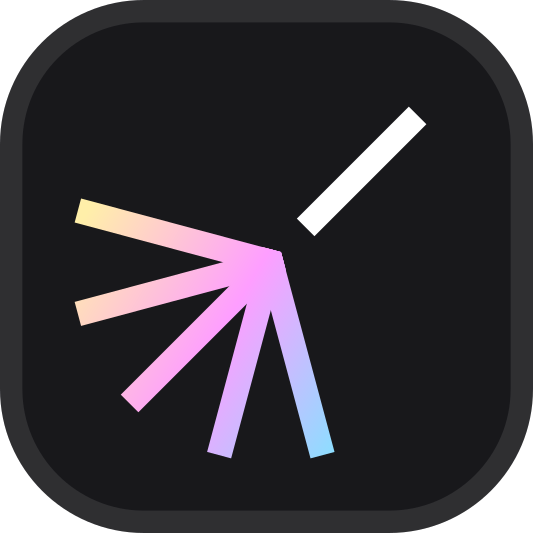
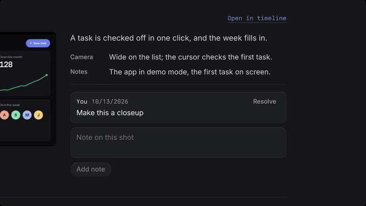
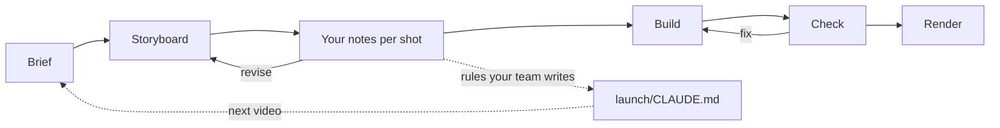
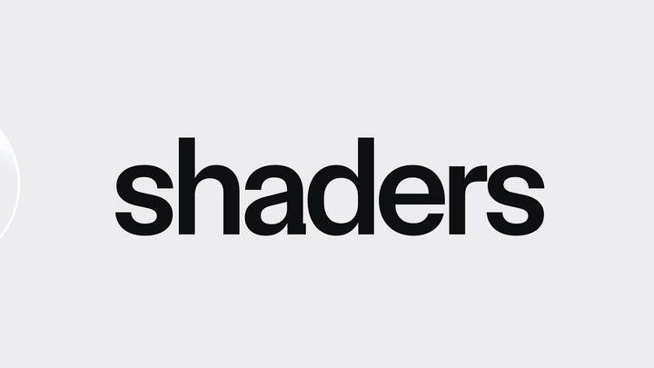

# Intentface Launch

Product launch videos written as code, made together with an agent.

Intentface Launch is an exploration. We built it for our own launch videos and keep developing it as we explore programmatic video. It is made to be shaped by product teams around their own product, brand and way of working: videos import the product's own components and record the running app, a team's look comes in as an add-on, and its workflow is written down where Claude reads it. Treat it as a harness to adapt, not a finished product.

[](LICENSE)
[](https://www.npmjs.com/package/@intentface-launch/core)
[](https://launch.intentface.com/skills)
<!-- TODO(joni): add a CI badge once a CI workflow exists (only publish.yml today) -->

<!-- TODO(joni): drag-drop the trailer MP4 here in the GitHub editor for inline playback -->
[](https://www.youtube.com/watch?v=psV-O07yDBg)

*Intentface Launch, made with Intentface Launch. [Watch the full trailer](https://www.youtube.com/watch?v=psV-O07yDBg).*

## Quick start

You need Node 22 or later and ffmpeg, plus [uv](https://docs.astral.sh/uv/) for beat detection and Claude Code to make videos with the skills. [Requirements](https://launch.intentface.com/requirements) has the full list and what it has been tested on.

Start your product's dev server (in its demo or seeded mode), then run these from the product repo's root:

```sh
brew install ffmpeg uv
npx @intentface-launch/core init    # the package, a launch/ folder and the skills
pnpm launch setup                   # the browser renders use, once per machine
pnpm launch dev                     # the studio, at http://localhost:4400
```

Then open Claude Code in the repo and ask for a video:

> Look at my app and make a feature release video about our scheduling feature, 30 seconds.

`init` works with pnpm, npm, yarn and bun (in an npm repo, run the CLI as `npx intentface-launch <command>`). It adds `@intentface-launch/core` as a dev dependency, a `launch` script, the skills in `.claude/skills/`, and:

```text
launch/
├── launch.config.ts   # points at the product, so videos import its components
├── CLAUDE.md          # how Claude works here, and how your team makes videos
├── tsconfig.json      # the product's paths (@/…)
└── videos/            # one folder per video: video.tsx, brief.md, captures/, audio/
```

[Quick start](https://launch.intentface.com/quick-start) also covers working from a checkout of this repo, and updating.

## How it works

The `product-launch-video` skill takes the request from there. Each step is agreed with you before the next one starts:

1. **Discover.** Claude reads and runs your product, then asks what only you know: what sets it apart and who it is for. The result is `brief.md`.
2. **Script.** One person doing one real task, each feature the next thing that happens in it.
3. **Music.** It does not make music; it cuts the video to a track. Use yours, or generate one from the brief Claude writes. `pnpm launch beats` finds the beats.
4. **Sketch.** Claude captures the product and builds every shot flat and cheap, as a storyboard and animatic you leave notes on per shot.
5. **Build.** Shots are finished one at a time, and Claude checks each in stills and contact sheets.
6. **Check and render.** `pnpm launch check` measures every piece of text on screen for reading time, size and contrast; `pnpm launch render` makes the mp4.



Underneath, a video is a React component made of shots. A renderer seeks each frame in headless Chromium and encodes the frames with ffmpeg into a 1080p60 (or 4K) mp4. Every frame is a pure function of its number, so any frame renders alone, in any order, in parallel, the same every time. [How it works](https://launch.intentface.com/how-it-works) has the details.

### A video in code

You can also write videos yourself: `pnpm launch new hello` scaffolds `launch/videos/hello/video.tsx`. A small one:

```tsx
import { defineVideo, spring, tempo, useFrame, useVideoInfo } from "@intentface-launch/core";
import { Slam } from "@intentface-launch/core/kit";

const t = tempo(120, 60); // 120 BPM at 60 fps: 30 frames a beat

function Hook() {
  const frame = useFrame(); // frames since this shot began: the only clock a scene reads
  const { fps } = useVideoInfo();
  const line = spring(frame - t.beats(2), fps, { duration: t.beats(1), bounce: 0.2 });
  return (
    <div style={{ position: "absolute", inset: 0, display: "grid", placeItems: "center", background: "#0b0b0f" }}>
      <div style={{ font: "600 120px system-ui", color: "white" }}>
        <Slam at={t.beats(1)}>Ship it.</Slam>
        <div style={{ height: 8, marginTop: 16, background: "#7c5cff", transformOrigin: "left", scale: `${line} 1` }} />
      </div>
    </div>
  );
}

export default defineVideo({
  id: "hello",
  title: "Hello",
  bpm: t.bpm,
  shots: [{ id: "hook", duration: t.bars(1), component: Hook }],
});
```

The headline slams in on the first beat and the line springs in on the second. The commands you will use most:

| Command | What it does |
| --- | --- |
| `pnpm launch still hello --at hook:end` | Renders one frame to look at |
| `pnpm launch sheet hello --shot hook` | A contact sheet of a shot's motion |
| `pnpm launch board hello` | Storyboard and animatic, for review |
| `pnpm launch check hello` | Text, timing, contrast and loudness checks |
| `pnpm launch render hello --preview` | A quick review cut |
| `pnpm launch render hello` | The 1080p60 mp4 |

[Commands](https://launch.intentface.com/commands) lists them all; [Engine](https://launch.intentface.com/engine) and [Kit](https://launch.intentface.com/kit) document what scenes import.

## Make it yours

Core is brand-neutral. A video takes its look from your product, and the rest is yours to shape:

- **Your own components.** `launch.config.ts` points at the product, so its `@/…` paths resolve in videos and its components and data import as they do in the app. Capture scripts record the running app frame by frame, and snapshots keep its DOM and CSS sharp at any zoom.
- **Your brand as an add-on.** A brand is a package with your fonts, logos and design, motion and copy rules. `pnpm launch add <package>` installs it and links its guide into `launch/CLAUDE.md`.
- **Your workflow in `launch/CLAUDE.md`.** Write how your team makes videos there (lengths, formats, music, tone, what never to show). Claude reads it whenever it works in the launch folder, `pnpm launch update` keeps it, and rules you add after reviewing one video carry into the next. See [Write down how your team works](https://launch.intentface.com/recipes#write-down-how-your-team-works).
- **Recipes.** Start from screenshots of what to highlight, your own clips and music, or a recipe written once, such as a weekly update. See [Recipes](https://launch.intentface.com/recipes).
- **A fork.** To change the skills or the engine for your team, fork this repo: a checkout is a launch folder itself, and a product repo can install from it. See [Work from a checkout](https://launch.intentface.com/quick-start#work-from-a-checkout).

## Made with Intentface Launch

| Video | What it shows |
| --- | --- |
| [Intentface Launch, made with Intentface Launch](https://www.youtube.com/watch?v=psV-O07yDBg) | This repo's own trailer: one prompt in a product repo, to a board, to the finished video. Source in [`videos/intentface-launch/`](videos/intentface-launch/). |
| [Intentface Events launch video](https://www.youtube.com/watch?v=wvBYZFLCv0Y) | A product launch made from the running app. |
| [Intentface Shaders demo](https://www.youtube.com/watch?v=91ejkTrWFwI) | A showcase of the [shaders add-on](https://launch.intentface.com/shaders), with core's flame, book and page curl, on type and a logo. |
| [Ei virheitä podcast intro](https://youtu.be/RQwKO6B9Y8g?t=52) | The intro of the podcast's first episode, from 0:52. |

[](https://www.youtube.com/watch?v=91ejkTrWFwI)

*From the Shaders demo: a glass lens over the type, then a liquid-glass cursor slices the word apart. [Watch the full demo](https://www.youtube.com/watch?v=91ejkTrWFwI).*

Made something with Intentface Launch? Let us know! Send it to [Joni on X](https://x.com/jonijuup) or [on LinkedIn](https://www.linkedin.com/in/jonim/), or [open an issue](https://github.com/Intentface/intentface-launch/issues/new) with a link. [Made with Intentface Launch](https://launch.intentface.com/made-with) has them all.

The [Examples](https://launch.intentface.com/examples) page has reusable patterns (AI products, UI changing state, kinetic type, camera, shaders), each a small component in [`videos/`](videos/).

## Packages

| Package | What it is |
| --- | --- |
| [`@intentface-launch/core`](https://www.npmjs.com/package/@intentface-launch/core) | Engine, kit (camera, cursor, captures, kinetic type, transitions), CLI, studio, and the skills Claude uses. |
| [`@intentface-launch/three`](https://www.npmjs.com/package/@intentface-launch/three) | 3D add-on: live UI on panels in space, real lens depth of field. `pnpm launch add three` |
| [`@intentface-launch/shaders`](https://www.npmjs.com/package/@intentface-launch/shaders) | Shader add-on: the [Shaders library](https://shaders.com)'s WebGPU effects on the video's clock. `pnpm launch add shaders` |

The skills also install on their own, to read or try: as a Claude Code plugin (`/plugin marketplace add Intentface/intentface-launch`) or with `npx skills add Intentface/intentface-launch`. In a product repo, use `init` instead, which installs the skills that match the package version. See [Skills](https://launch.intentface.com/skills).

## Status and requirements

Experimental and 0.x: APIs, commands and skills change between versions, and 0.1.1 and 0.2.0 shipped broken npm installs (fixed in 0.2.1; see the [changelog](https://launch.intentface.com/changelog)). It is developed and tested on one setup, an Apple M2 Pro Mac with Claude Opus 5.5 at High effort in Claude Code. Other operating systems, GPUs and models are untested, and without a GPU rendering falls back to software and is much slower.

Use it at your own risk. It is provided as is, without warranty (see [LICENSE](LICENSE)). Making a video means an agent runs commands, starts your product, drives a browser through it and writes files in your repos: review what it does, work in version control, and use a demo account or seeded data so no secrets end up in frames. [Requirements](https://launch.intentface.com/requirements) has the details.

## Compared with other tools

There are good options for video as code, each suited to different work: [HyperFrames](https://hyperframes.dev) for agent-made videos from a URL or brief across many agents, [Remotion](https://www.remotion.dev) as a solid React framework for production work, [snapcn](https://snapcn.dev) for recreated product-demo shots on Remotion, and Motion Canvas, Revideo or Manim for drawn explainers. Intentface Launch is narrower: launch videos made from a product's own source and running UI, shaped to a team's brand and workflow. [Compared with other tools](https://launch.intentface.com/comparison) describes each on its own terms. Try a few and see what works best for you.

## Contributing

```sh
pnpm install
pnpm launch setup
pnpm dev          # this repo is a launch folder too, for its own videos in videos/
pnpm check        # types, lint and video checks
pnpm docs         # the docs site, at http://localhost:4410
```

[CLAUDE.md](CLAUDE.md) explains how the packages fit together. The `videos/test-*` folders are the tests: each says at its top what it exercises, the command to run and what a correct result is. The docs' source is in [`docs/content/docs/`](docs/content/docs/). Ideas for tools are issues labelled [`wishlist`](https://github.com/Intentface/intentface-launch/issues?q=is%3Aissue+is%3Aopen+label%3Awishlist).

## Licence

MIT for the software. The Intentface and Intentface Launch names and logos, including the Launch mark, are trademarks of Intentface and not covered by it. See [LICENSE](LICENSE).

Made by [Intentface](https://intentface.com).
